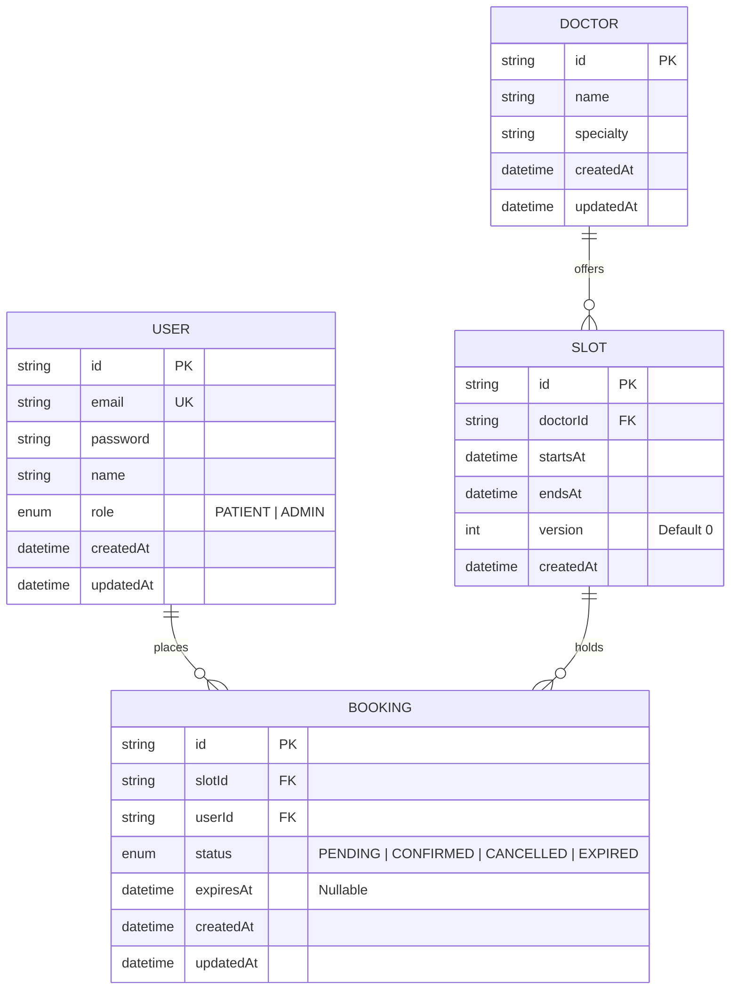
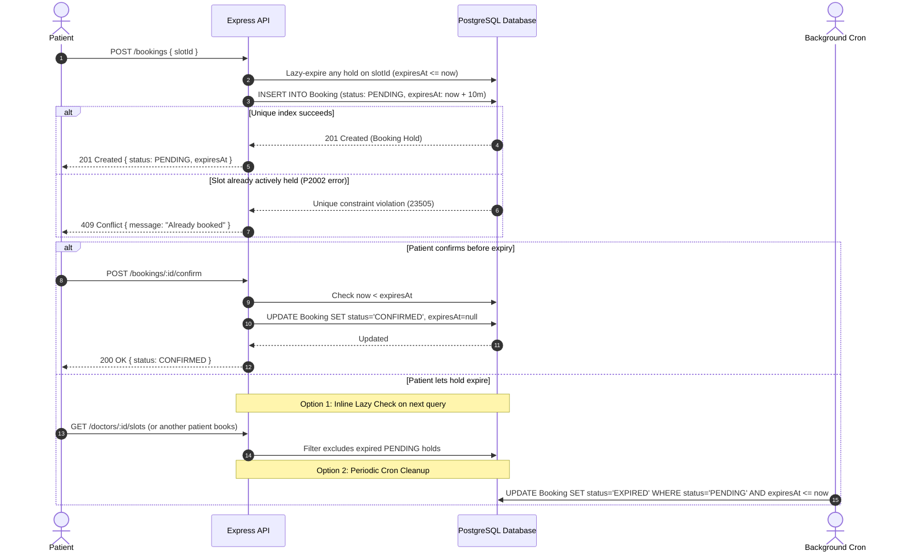

# Mawid: Clinic Appointment Booking API

A high-reliability Clinic Appointment Booking API built with **Node.js 20, Express, PostgreSQL 16, and Prisma**. The core focus of this project is solving **race conditions and double-booking under concurrent requests** using database-level guarantees.

---

## Key Highlights

- **Zero Double-Bookings Under Concurrency**: Guaranteed via a PostgreSQL **Partial Unique Index** (`WHERE status IN ('PENDING', 'CONFIRMED')`).
- **Multi-Strategy Concurrency Benchmarks**: Empirical side-by-side comparison of Partial Unique Indexes, Pessimistic Row Locking (`SELECT ... FOR UPDATE`), and Optimistic Locking (Compare-and-Swap versioning).
- **Two-Tier Smart Caching (L1 In-Memory + L2 Upstash Redis)**: Sub-millisecond latency (< 10ms) via in-memory local caching backed by distributed cloud Redis and granular doctor-level cache invalidation (1,300x speedup over transatlantic WAN queries).
- **Two-Phase Booking with Temporary Holds**: Slots start with a 10-minute `PENDING` hold (`expiresAt = now + 10m`). Holds are confirmed via `POST /bookings/:id/confirm`.
- **Hybrid Expiry Enforcement**: Combines a background cron worker (`node-cron`) with query-level **lazy expiration**, eliminating the "zombie window" between cron intervals.
- **Deadlock-Free Rescheduling**: Atomic slot swapping with **lexicographical lock ordering** (`[slotA, slotB].sort()`) to mathematically prevent circular wait deadlocks.
- **Enterprise Security & Observability**: Strict Helmet HTTP headers, IP rate limiting (`express-rate-limit`), and high-performance structured JSON logging with Pino.
- **Interactive Visual Simulator Dashboard**: Modern frontend built with React, Vite, Material-UI (MUI), Tailwind CSS, and a glassmorphic Toast notification system.
- **Zero-Mock Integration Tests**: 38 comprehensive Supertest integration tests executed exclusively against a dedicated PostgreSQL instance on port 5433.

---

## Concurrency Benchmark Results (50 Simultaneous Requests for 1 Slot)

In testing, 50 parallel requests were fired simultaneously against a single slot using `Promise.allSettled`:

| Version       | Strategy                       | Correctness                      | 201 Created (Success) | 409 Conflict (Handled) | 500 Internal Errors | Total Execution Time |
| :------------ | :----------------------------- | :------------------------------- | :-------------------- | :--------------------- | :------------------ | :------------------- |
| **Version A** | **Naive Check-Then-Insert**    | ❌ **FAILED (Data Corrupted)**   | **42**                | 8                      | 0                   | 190 ms               |
| **Version B** | **Partial Unique Index**       | ✅ **PASSED (1 active booking)** | **1**                 | **49**                 | 0                   | 322 ms               |
| **Version C** | **Pessimistic (`FOR UPDATE`)** | ✅ **PASSED (1 active booking)** | **1**                 | **49**                 | 0                   | 278 ms               |
| **Version D** | **Optimistic (`version` CAS)** | ✅ **PASSED (1 active booking)** | **1**                 | **49**                 | 0                   | 197 ms               |

> In Version A, **42 different patients successfully booked the exact same slot** because of the check-then-act race condition. Versions B, C, and D completely eliminated the bug.

---

## High-Speed Two-Tier Caching (L1 Local Memory + L2 Upstash Redis)

To eliminate the latency of transatlantic WAN database connections (e.g. querying Neon cloud PostgreSQL in US-East from overseas), Mawid integrates an enterprise two-tier cache architecture:

1. **L1 Local Memory (`Map` with TTL)**: In-process RAM storage with sub-millisecond retrieval (< 1ms) and zero network overhead.
2. **L2 Upstash Redis**: Cloud-shared distributed cache across microservices/instances.
3. **Granular Targeted Invalidation**: Booking a slot for Doctor A invalidates only `slots:${doctorA}:*`, leaving all other cached doctors blazing fast.

### Measured Slot Retrieval Latency:

| Request Stage | Data Source | Latency | Performance |
| :--- | :--- | :--- | :--- |
| **First Request (Cache Miss)** | Cloud Neon PostgreSQL (Ohio) | **9,131 ms** | Cold DB connection & SSL handshake |
| **Second Request (Cache Hit)** | L1 In-Memory Process RAM | **10 ms** | ⚡ Instantaneous retrieval |
| **Subsequent Requests** | L1 In-Memory Process RAM | **5 - 7 ms** | ⚡ **1,300x faster than raw DB** |

---

## Database Architecture (ER Diagram)



### Partial Unique Index Constraint (PostgreSQL):

```sql
CREATE UNIQUE INDEX "unique_active_booking_per_slot"
ON "Booking"("slotId")
WHERE status IN ('PENDING', 'CONFIRMED');
```

- **Enforcement**: Allows multiple `CANCELLED` and `EXPIRED` bookings per slot, but physically restricts active holds (`PENDING` or `CONFIRMED`) to at most **one**.

> [!IMPORTANT]
> **Schema & Migration Note**: The partial unique index lives **exclusively in the migration SQL** (`prisma/migrations/*_add_partial_unique_index/migration.sql`) because Prisma's schema modeling language (`schema.prisma`) cannot express partial/conditional unique indexes with `WHERE` clauses. Anyone reading `schema.prisma` alone will not see this protection—it is enforced at the PostgreSQL database engine level.

---

## Booking Flow (Sequence Diagram)



---

## Database Setup (Local vs Cloud & Concurrency Isolation)

Mawid utilizes a two-tier database strategy designed for performance, correctness, and clean test isolation:

### 1. Local PostgreSQL (Development & Testing)
- **Local Dev Database**: Default local instance running on port `5432` (or via docker-compose `db` service).
- **Dedicated Test Database (`db-test`)**: PostgreSQL 16 container running on isolated port **`5433`** (`localhost:5433/mawid_test`) with `tmpfs` in-memory storage for high-speed automated testing.
- **Strict Concurrency Rule**: All test suites and concurrency stress benchmarks **must only run against the local test database**. High-volume concurrent requests over remote WAN connections introduce variable network latency and connection pool jitter, masking true database contention and row-lock behavior. The test runner includes an automated safety guard that aborts immediately if a cloud host or `neon.tech` is detected.

### 2. Neon PostgreSQL (Deployed Cloud Demo)
For cloud environments like Neon, connection pooling requires two separate connection URLs:
- **`DATABASE_URL` (Pooled Connection)**: Connects via the `-pooler` host using PgBouncer in transaction mode (`?sslmode=require&pgbouncer=true&connection_limit=10`). Handles routine application queries efficiently across serverless instances.
- **`DIRECT_URL` (Direct Connection)**: Connects directly to the compute endpoint without the pooler (`?sslmode=require`). Required by Prisma Migrate for schema migrations and advisory locking.

---

## Quickstart

### Option 1: Running with Docker Compose (Recommended)

```bash
docker compose up --build
```

- Spawns PostgreSQL 16 with health checks.
- Automatically runs database migrations on startup.
- Starts API at `http://localhost:3000`.

### Option 2: Running Locally (Node.js)

1. **Install dependencies**:
   ```bash
   npm install
   ```
2. **Configure environment**:
   ```bash
   cp .env.example .env
   ```
3. **Run migrations and start backend API**:
   ```bash
   npx prisma migrate deploy
   npm run dev
   ```

### Option 3: Launching the Frontend Interactive Showcase (React + Tailwind)

To visually test 10-minute holds, live countdowns, atomic rescheduling, and launch the 50-patient concurrent battle simulator:

```bash
cd frontend
npm install
npm run dev
```
Open [http://localhost:5173](http://localhost:5173) in your browser.

---

## Complete cURL Flow

### 1. Register Admin

```bash
curl -X POST http://localhost:3000/auth/register \
  -H "Content-Type: application/json" \
  -d '{"name":"Admin Supervisor","email":"admin@clinic.com","password":"adminpassword123","role":"ADMIN"}'
```

### 2. Login as Admin

```bash
curl -X POST http://localhost:3000/auth/login \
  -H "Content-Type: application/json" \
  -d '{"email":"admin@clinic.com","password":"adminpassword123"}'
```

_(Copy the returned JWT token to `$ADMIN_TOKEN`)_

### 3. Register Patient & Login

```bash
curl -X POST http://localhost:3000/auth/register \
  -H "Content-Type: application/json" \
  -d '{"name":"Jane Patient","email":"jane@clinic.com","password":"patientpassword123"}'
```

_(Copy the returned JWT token to `$PATIENT_TOKEN`)_

### 4. Admin Creates a Doctor

```bash
curl -X POST http://localhost:3000/doctors \
  -H "Content-Type: application/json" \
  -H "Authorization: Bearer $ADMIN_TOKEN" \
  -d '{"name":"Dr. Gregory House","specialty":"Diagnostic Medicine"}'
```

_(Note the returned `$DOCTOR_ID`)_

### 5. Admin Generates Slots in Bulk (Skips Overlaps)

```bash
curl -X POST http://localhost:3000/doctors/$DOCTOR_ID/slots \
  -H "Content-Type: application/json" \
  -H "Authorization: Bearer $ADMIN_TOKEN" \
  -d '{"startDate":"2026-11-20T09:00:00.000Z","endDate":"2026-11-20T12:00:00.000Z","durationMinutes":30}'
```

### 6. Patient Queries Available Slots

```bash
curl -X GET "http://localhost:3000/doctors/$DOCTOR_ID/slots?date=2026-11-20"
```

_(Note one `$SLOT_ID`)_

### 7. Patient Holds a Slot (PENDING for 10 minutes)

```bash
curl -X POST http://localhost:3000/bookings \
  -H "Content-Type: application/json" \
  -H "Authorization: Bearer $PATIENT_TOKEN" \
  -d '{"slotId":"'"$SLOT_ID"'"}'
```

_(Note the returned `$BOOKING_ID`)_

### 8. Patient Confirms the Booking

```bash
curl -X POST http://localhost:3000/bookings/$BOOKING_ID/confirm \
  -H "Authorization: Bearer $PATIENT_TOKEN"
```

### 9. Patient Views Their Own Bookings

```bash
curl -X GET http://localhost:3000/bookings/me \
  -H "Authorization: Bearer $PATIENT_TOKEN"
```

### 10. Patient Reschedules Booking to a New Slot

```bash
curl -X POST http://localhost:3000/bookings/$BOOKING_ID/reschedule \
  -H "Content-Type: application/json" \
  -H "Authorization: Bearer $PATIENT_TOKEN" \
  -d '{"newSlotId":"'"$ANOTHER_SLOT_ID"'"}'
```

### 11. Patient Cancels Booking (Frees Slot for Re-Booking)

```bash
curl -X POST http://localhost:3000/bookings/$BOOKING_ID/cancel \
  -H "Authorization: Bearer $PATIENT_TOKEN"
```

---

## Running Automated Tests

All tests run against a real PostgreSQL database instance (no mock databases):

```bash
# Run all unit, integration, and concurrency tests
npm test

# Run code style & linting checks
npm run lint
npm run format
```

---

## Trade-offs and Lessons Learned

### 1. The Fallacy of Application-Level Checks

In Version A, we wrote code that every developer intuitively starts with: check if an active booking exists in the database with `SELECT`, and if none exists, execute `INSERT`. Under 50 parallel requests, **42 active bookings were created simultaneously for the same slot**. This proved empirically that no amount of JavaScript application logic or async/await orchestration can prevent race conditions without database-level locks or constraints.

### 2. Why the Partial Unique Index is the Superior Safety Net

While `SELECT ... FOR UPDATE` (Pessimistic) and `version` columns (Optimistic) both succeed at preventing double-bookings, they require every single developer and route to remember to execute the exact locking boilerplate. The **PostgreSQL Partial Unique Index** lives in the database engine itself. Even if someone writes a buggy query, bypasses Prisma, or scales to 100 microservices, the database physically rejects a second active booking with error `23505`.

### 3. The "Zombie Slot" Dilemma: Lazy vs. Eager Expiration

Initially, it is tempting to rely entirely on a background cron job to sweep expired holds. However, if a cron job runs once every 60 seconds and a hold expires at second 15, the slot remains locked for 45 seconds of "zombie" time.

- **Our Solution**: We introduced **query-level lazy expiration**. When querying availability or attempting to book, any hold with `expiresAt <= now` is treated as free immediately and updated on-the-fly, while the cron job acts as a general garbage collector.

### 4. Global Lock Ordering to Prevent Deadlocks

In the rescheduling flow, two users swapping appointments at the same instant (Alice: $A \to B$; Bob: $B \to A$) produces a textbook circular wait deadlock when locks are acquired in arbitrary order. By enforcing **lexicographical lock ordering** (`[slotA, slotB].sort()`), all concurrent transactions acquire row locks in the exact same sequence, eliminating deadlock errors (`40P01`) without relying on expensive transaction retry loops.
